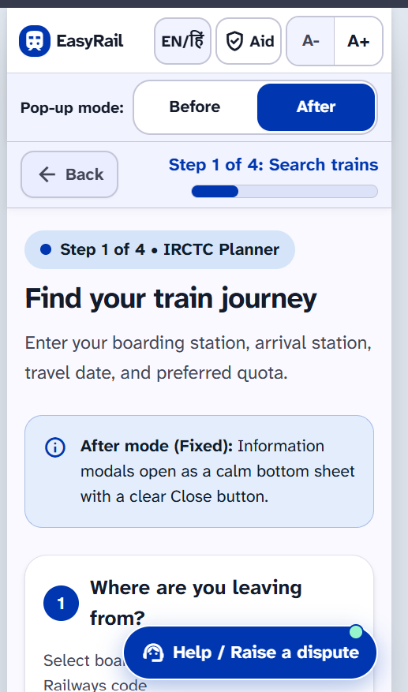
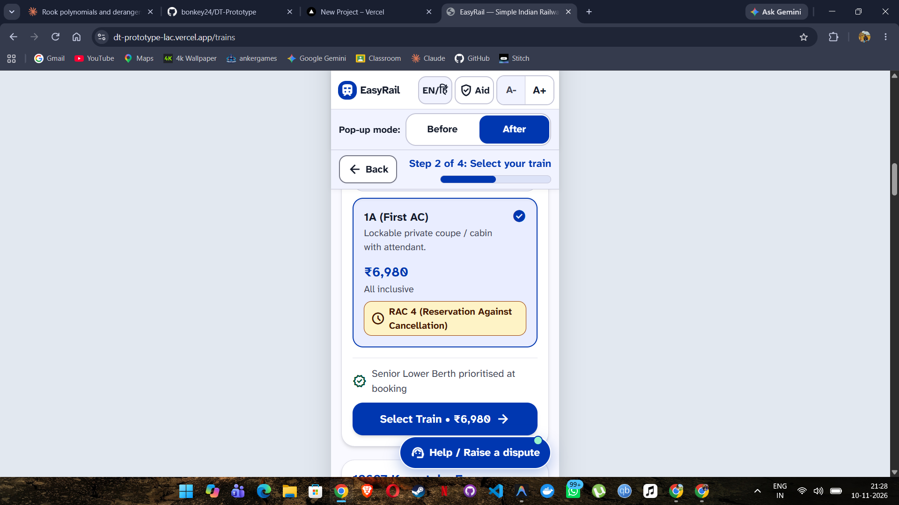
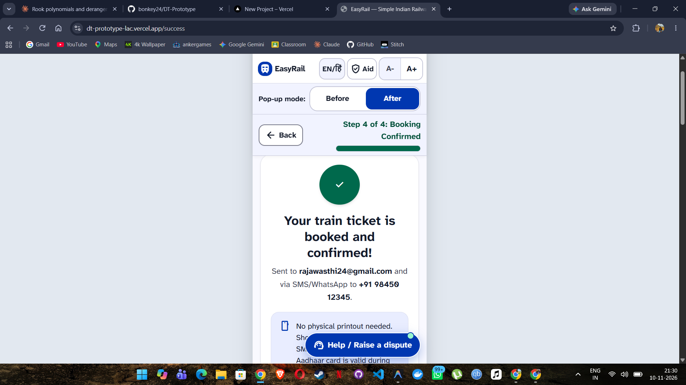
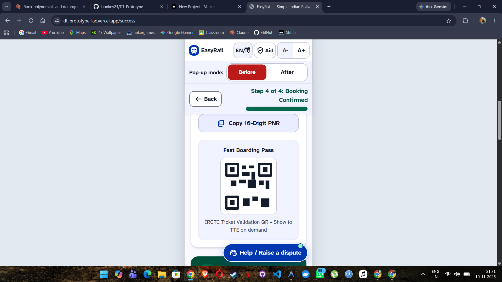
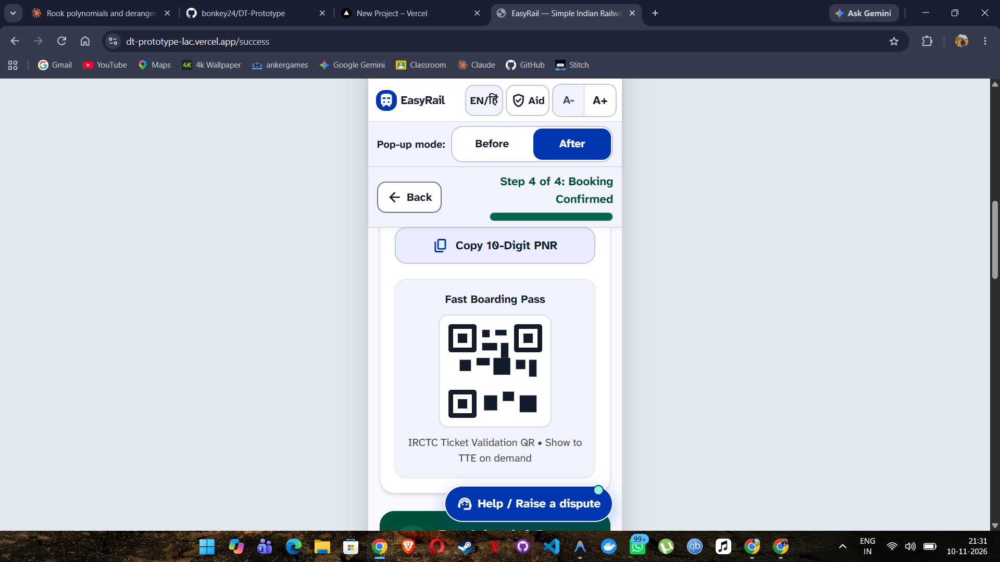
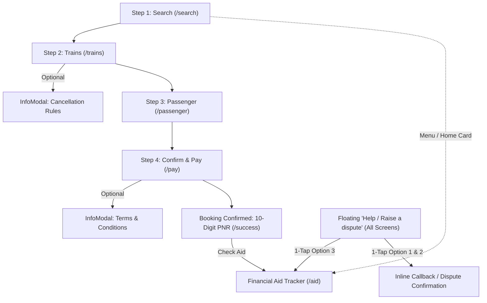
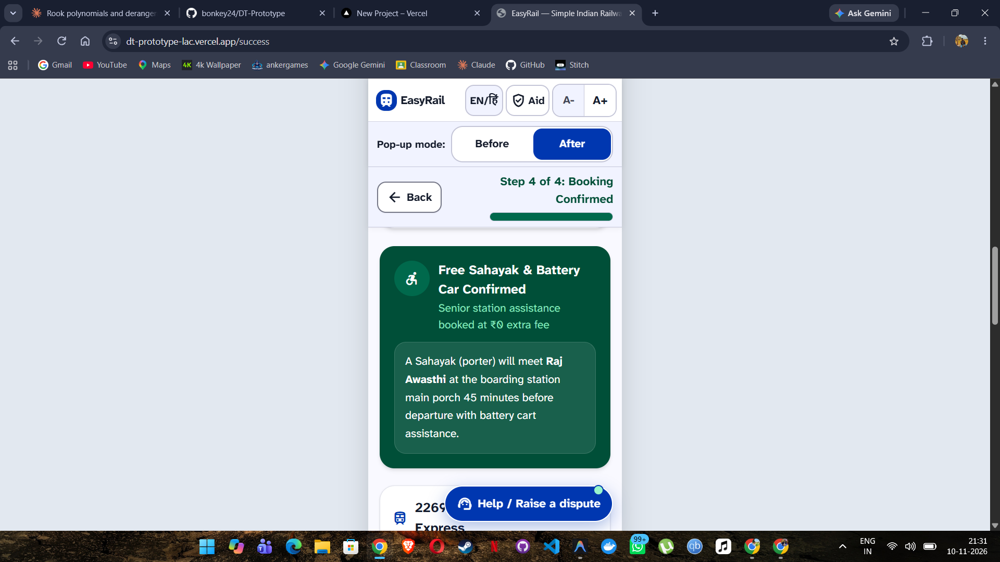
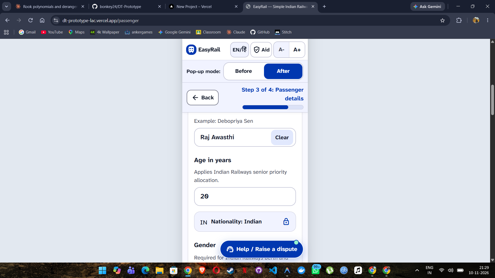
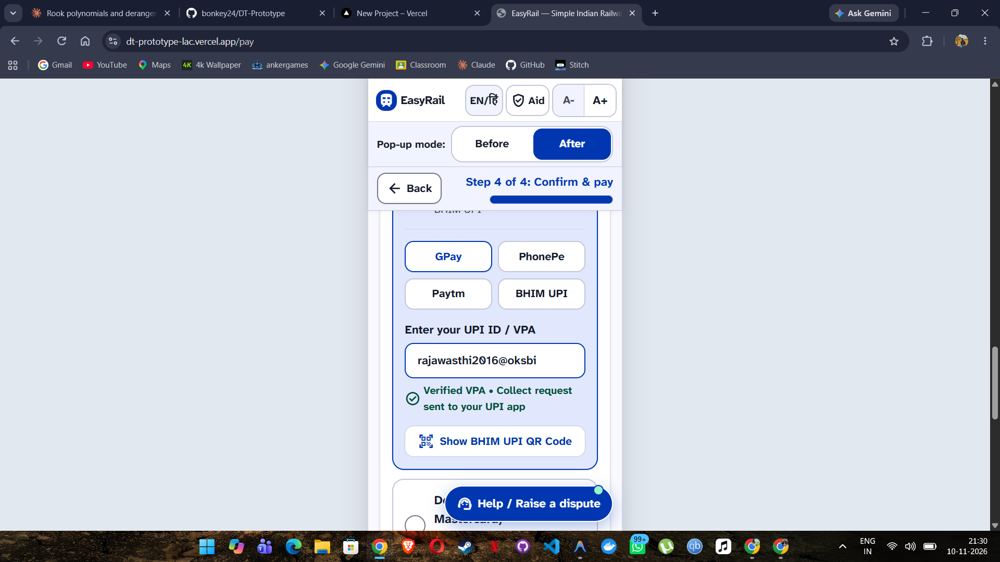
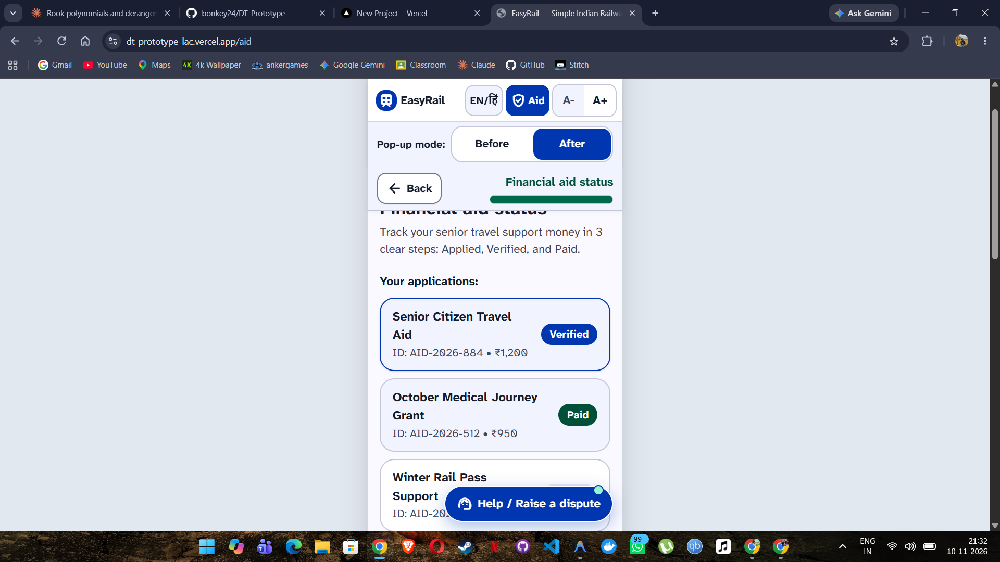

<div align="center">

# EasyRail

**Calm, accessible mobile train ticket booking designed for elderly and non-expert users.**

[](https://dt-prototype-lac.vercel.app/)
[](https://github.com/bonkey24/DT-Prototype)
[](https://react.dev/)
[](https://vite.dev/)
[](https://tailwindcss.com/)
[](https://dt-prototype-lac.vercel.app/)
[](https://www.w3.org/WAI/standards-guidelines/wcag/)
[](#)
[](#how-it-was-built)

<br />

<a href="https://dt-prototype-lac.vercel.app/">
  
</a>

<br /><br />

<table>
  <tr>
    <td align="center">
      <br />
      <sub><strong>1. Search Trains</strong></sub>
    </td>
    <td align="center">
      <br />
      <sub><strong>2. Select Train &amp; Class</strong></sub>
    </td>
    <td align="center">
      <br />
      <sub><strong>3. Confirmed 10-Digit PNR</strong></sub>
    </td>
  </tr>
</table>

</div>

---

## 🎯 The Problem

> **Persona — Debopriya (Retiree)**
> Debopriya wants to book train tickets independently on her phone, but abandons bookings mid-way when full-screen, jargon-heavy pop-ups (cancellation rules, terms, fee notices) block her screen and hide dismissal behind a tiny, low-contrast `x` button.

This prototype focuses on Debopriya's pop-up barrier while also addressing two related accessibility breakdowns from the same research theme:

- **Delivery driver — dispute option buried in nested menus:** Solved with a persistent floating **`Help / Raise a dispute`** button on every screen that opens a 1-tap, 3-option support sheet.
- **Farmer — financial aid status hard to check:** Solved with a plain-language **`Financial aid status`** tracker (`/aid`) using a 3-step visual stepper (`Applied → Verified → Paid`), reachable directly from the header, home screen, confirmation screen, and help sheet.

---

## 🔍 Before vs After: Fixing the Pop-Up

The header includes a global **`Before / After`** toggle so evaluators can experience the exact breakdown alongside the accessible fix using the same `<InfoModal />` component.

> **Note:** **Before** mode is *deliberately frustrating*—it recreates the dense full-screen legal wall of text and tiny faint `x` button that causes elderly users to get stuck and quit.

<table>
  <tr>
    <th width="50%">Before (The Problem)</th>
    <th width="50%">After (The Accessible Fix)</th>
  </tr>
  <tr>
    <td align="center">
      
    </td>
    <td align="center">
      
    </td>
  </tr>
</table>

| Metric | Before (Old App) | After (EasyRail Fix) |
| --- | --- | --- |
| **Close button size** | `23×23px` faint `x` icon | `106×49px` high-contrast labelled `Close ✕` button |
| **Bottom thumb CTA** | None | Full-width `354×57px` **`Got it`** button |
| **Dismissal methods** | `1` (tiny `x` button only) | `4` (`Close` / `Got it`, tap outside, swipe down, `Esc` key) |
| **Text presentation** | Dense wall of legal prose | 3 plain-language bullet cards + **`Read more`** expander |
| **Screen context** | Blocks 100% of the screen | Rounded bottom sheet over dimmed page so progress stays visible |

---

## 🗺️ User Journey



---

## ♿ Accessibility Decisions

| Decision | Why it matters for Debopriya |
| --- | --- |
| **18px+ base font & `A- / A+` header toggle** | Scales root typography smoothly (`18px` → `20px` → `22px`) without horizontal overflow or clipped labels; nothing renders under `16px`. |
| **`48×48px+` tap targets everywhere** | Prevents missed taps or accidental clicks on small mobile screens for older fingers. |
| **Visible text labels on buttons** | Eliminates guesswork from icon-only controls (`Close ✕`, `Back`, `Help / Raise a dispute`, `Aid`). |
| **WCAG AA+ colour contrast** | High-contrast deep blue (`#0037b0`), dark slate (`#141b2b`), and deep green (`#004f38`) keep labels readable without eye strain. |
| **Status never by colour alone** | `CNF`, `AVAILABLE`, `RAC`, and `WL` chips always pair colour with clear text labels and icons. |
| **Inline banners instead of `alert()` dialogs** | Validation errors, senior priority notices, and dispute confirmations appear calmly inline without hijacking the screen. |
| **Always-visible `Back` button & `Step X of 4`** | Sticky progress bar ensures Debopriya always knows where she is and how to return safely. |
| **Focus trap, `aria-modal`, & focus return** | Keyboard and assistive-tech users stay inside open dialogs (`Tab` / `Shift+Tab`) and return directly to the trigger button upon closing. |
| **Bottom sheet within thumb reach** | Keeps primary dismissal (`Got it`) at the bottom of the `390px` viewport and supports swipe-down and backdrop taps. |

<div align="center">
  <br />
  <sub><em>Verified at <code>A+</code> (<code>22px</code>) on a <code>390px</code> viewport — zero clipped text or horizontal overflow.</em></sub>
</div>

---

## 🚆 Indian Railways Context

To feel realistic and recognizable to Indian senior travellers, mock data and formatting follow Indian Railways conventions:

- **Stations with codes:** `Bengaluru City Jn (SBC)`, `New Delhi (NDLS)`, `Mumbai CSMT (CSMT)`, `Chennai Central (MAS)`, `Howrah Jn (HWH)`, `Hyderabad (HYB)`, `Delhi Hazrat Nizamuddin (NZM)`
- **Trains & classes:** 5 express/superfast trains (`22691`, `12627`, `12649`, `12007`, `16524`) across `SL`, `3A`, `2A`, `1A`, `CC`, and `2S`
- **Quotas & berths:** Senior Citizen / Lower Berth (`SS`), General (`GN`), Ladies (`LD`), Tatkal (`CK`), Premium Tatkal (`PT`), and explicit berth preferences (`Lower Berth`, `Side Lower`, etc.)
- **Fares, dates & times:** Indian Rupee formatting (`₹2,845`), `DD-MM-YYYY` dates, 24-hour departure/arrival times (`20:00`, `05:55`), UPI options (`GPay`, `PhonePe`, `Paytm`, `BHIM UPI` + QR preview), and a generated 10-digit PNR on confirmation

> **Disclaimer:** This is an educational UX prototype using mock data only. It is not affiliated with IRCTC or Indian Railways.

---

## 🖼️ Screens Gallery

<details>
<summary><strong>View all 9 screens</strong></summary>

<br />

<table>
  <tr>
    <td align="center">
      <br />
      <sub><code>01-search.png</code> — Step 1 Search</sub>
    </td>
    <td align="center">
      <br />
      <sub><code>02-trains.png</code> — Step 2 Train List</sub>
    </td>
    <td align="center">
      <br />
      <sub><code>03-passenger.png</code> — Step 3 Passenger</sub>
    </td>
  </tr>
  <tr>
    <td align="center">
      <br />
      <sub><code>04-pay.png</code> — Step 4 Confirm &amp; Pay</sub>
    </td>
    <td align="center">
      <br />
      <sub><code>05-success.png</code> — Success &amp; 10-Digit PNR</sub>
    </td>
    <td align="center">
      <br />
      <sub><code>06-before-modal.png</code> — Before Modal</sub>
    </td>
  </tr>
  <tr>
    <td align="center">
      <br />
      <sub><code>07-after-modal.png</code> — After Bottom Sheet</sub>
    </td>
    <td align="center">
      <br />
      <sub><code>08-trains-a-plus.png</code> — A+ Large Text</sub>
    </td>
    <td align="center">
      <br />
      <sub><code>09-aid-status.png</code> — Aid Status Stepper</sub>
    </td>
  </tr>
</table>

</details>

---

## 🛠️ Tech Stack & Project Structure

| Layer | Technology |
| --- | --- |
| **Framework** | React 19 + React Router 7 |
| **Build Tool** | Vite 6 |
| **Styling** | Tailwind CSS v4 (`@tailwindcss/vite` + `@theme` tokens) |
| **Typography & Icons** | Atkinson Hyperlegible Next & Material Symbols Outlined (Google Fonts) |
| **Hosting** | Vercel |

```text
src/
├── App.jsx                   # Routes & persistent HelpButton
├── index.css                 # Tailwind v4 @theme tokens & base 18px typography
├── main.jsx
├── components/
│   ├── Header.jsx            # Brand, EN/हिं toggle, Aid link, A-/A+, Before/After
│   ├── HelpButton.jsx        # Persistent 1-tap 3-option Help / Dispute bottom sheet
│   ├── InfoModal.jsx         # Before (broken) vs After (accessible bottom sheet)
│   ├── PageShell.jsx         # Centered 390px mobile frame & sticky top bar
│   ├── ProgressBar.jsx       # Sticky Back button + "Step X of 4" bar
│   └── StepperStatus.jsx     # 3-step visual stepper (Applied -> Verified -> Paid)
├── context/
│   └── BookingContext.jsx    # Shared booking state, font size, & modal mode
├── data/
│   └── mock.js               # Stations, 5 trains, quotas, modal copy, aid data
└── pages/
    ├── Search.jsx            # /search (Step 1)
    ├── Trains.jsx            # /trains (Step 2)
    ├── Passenger.jsx         # /passenger (Step 3)
    ├── Confirm.jsx           # /pay (Step 4)
    ├── Success.jsx           # /success (Confirmation + 10-digit PNR)
    └── AidStatus.jsx         # /aid (Financial aid tracker)
```

| Route | Screen |
| --- | --- |
| `/search` | Step 1 — Search stations, date, quota, and class |
| `/trains` | Step 2 — Train list + Cancellation rules modal |
| `/passenger` | Step 3 — Passenger details, berth preference, and senior priority |
| `/pay` | Step 4 — Summary, fare breakdown, UPI/payment, and Terms modal |
| `/success` | Ticket confirmation with 10-digit PNR and next steps |
| `/aid` | Financial aid status (`Applied → Verified → Paid`) |

---

## 💻 Run Locally

```bash
git clone https://github.com/bonkey24/DT-Prototype.git
cd DT-Prototype
npm install
npm run dev
```

Build for production:

```bash
npm run build
```

---

## 🔨 How It Was Built

1. **Visual design in Google Stitch:** Generated reference screen designs (`Stitch Template/`) using *Atkinson Hyperlegible Next*, Material Symbols, and an accessible Material 3 blue/emerald palette.
2. **Implementation with Antigravity:** Built the React Router flow, `InfoModal` Before/After system, `HelpButton`, `StepperStatus`, and Indian Railways mock data, mapping the Stitch layouts into Tailwind v4 `@theme` tokens.
3. **Manual testing & accessibility adjustments:** Tested across all routes in headless Chrome at a `390px` mobile viewport and adjusted header spacing, status chips, and button targets to verify:
   - **No horizontal overflow** at `390px` width even with `A+` (`22px`) text enabled
   - **No tap target under `48px`** (excluding the deliberately tiny `23×23px` `Before` modal `x` button)
   - **No text under `16px`** anywhere in the accessible UI

---

## ⚠️ Limitations & Future Scope

- **Mock prototype only:** All train schedules, availability counts, PNR numbers, UPI confirmations, disputes, and financial aid statuses use client-side mock data—no real payments or backend APIs are connected.
- **Visual language toggle:** The `EN / हिं` button in the header is a visual UI control only; full UI translation is not wired up.

**Future improvements:**
- Full Hindi and regional language translation across labels, rules, and error banners
- Spoken audio guidance (`Web Speech API`) for rules and ticket confirmations
- Screen-reader verification on real devices with Android **TalkBack**
- Moderated usability testing with real senior citizens

---

<div align="center">

Author: **bonkey24** · Built for Design Thinking

**[Open Live Demo →](https://dt-prototype-lac.vercel.app/)**

</div>
